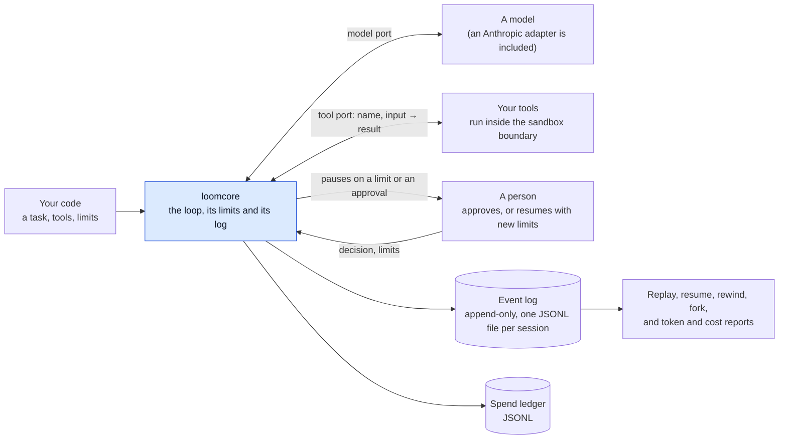
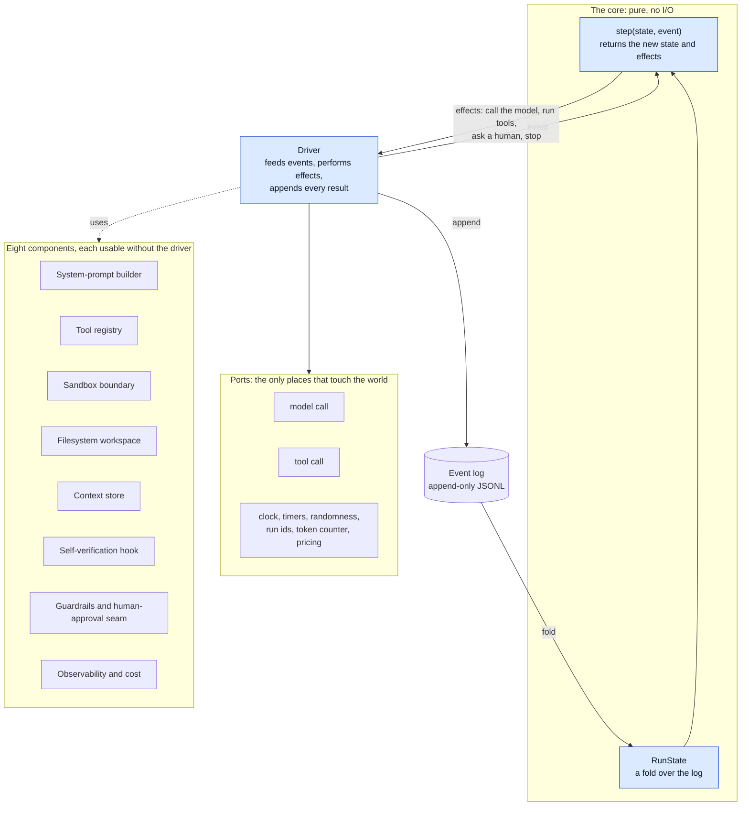
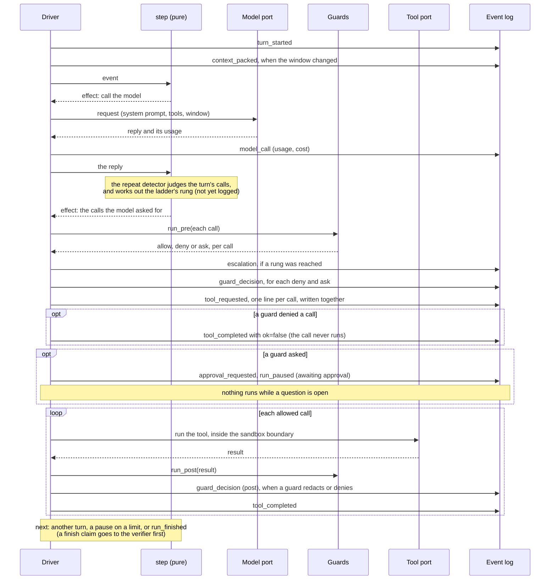
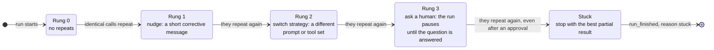
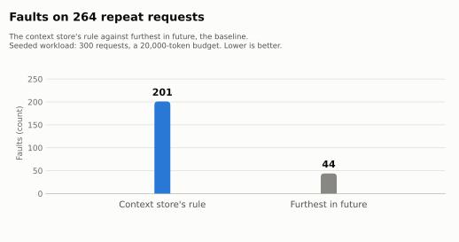

# `loomcore`

A small Python library that is an agent harness: the loop, tools, sandbox, context, guardrails and event log that sit around a model and turn it into an agent that can finish a task.

- [`loomcore`](#loomcore)
  - [What it is](#what-it-is)
  - [Where it fits](#where-it-fits)
  - [Architecture](#architecture)
  - [The key mechanism: one turn, and the escalation ladder](#the-key-mechanism-one-turn-and-the-escalation-ladder)
  - [How to use it](#how-to-use-it)
  - [What it measures](#what-it-measures)
  - [How not to use it](#how-not-to-use-it)
  - [Design](#design)
  - [References](#references)
  - [Licence](#licence)

**Status: v0.1.** The eight components in [spec.md](spec.md) are built and tested, a scripted eval runs the whole stack in CI, and a second project can install the built wheel and run a task (CI does that on every change). It needs Python 3.15 or later, and it is not on PyPI: install it from the `v0.1.0` tag on GitHub, which builds from source.

## What it is

An agent is a model plus a harness. The model reasons; the harness runs the loop, executes tools, keeps the model's context within budget, stops it when it should stop, and records everything. `loomcore` is that harness, kept small:

- a ReAct-style loop over the model's native tool use, written as a pure `step(state, event)` function;
- an append-only event log that is the only record of a run, so a run can be replayed, resumed or rewound;
- limits that are part of the core: turns, time, output size and two budget caps (per run and per month). Reaching one pauses the run with the reason named, and you resume it with the limits you choose;
- eight components, each usable without the driver: system-prompt builder, tool registry, sandbox boundary, filesystem workspace, context store, self-verification hook, guardrails with a human-approval seam, and observability with token-based cost.

It is built first for four projects that import it (`filingstrawl`, `finanalyst`, `harnessbench` and `streamsense`), and for anyone who wants to wire a model to a few tools and get a run that ends on purpose, with a log they can read.

## Where it fits

Your code gives `loomcore` a task, tools and limits. It runs the loop between a model and those tools, stops when the model finishes or a limit is reached, and writes every step to a log. The shaded box is `loomcore`; everything else is yours or a service you choose.



## Architecture

The core is one pure function, `step(state, event)`, that returns a new state and the effects to perform. A thin driver feeds it events, performs the effects through ports (the only places that touch the world) and appends every result to the log. The run's state is a fold over that log, which is why a run can be replayed or resumed. The eight components sit beside the core, and each works without the driver.



## The key mechanism: one turn, and the escalation ladder

One turn of the loop, as the log records it. The driver packs the context window, calls the model, and judges the calls the model asked for before any runs. A guard can deny a call or ask a person; an allowed call runs, and its result passes the post guards before it is logged. A claim that the task is finished goes to the verifier.



The escalation ladder is what happens when the model repeats itself. When identical calls reach the threshold (three of the last ten by default), the run climbs one rung for that turn. The rung belongs to the run, never goes down, and is logged as an `escalation` event.



## How to use it

Install it with the Anthropic model port (the one dependency of the core is `pydantic`; the SDK is an extra):

```bash
pip install "loomcore[anthropic] @ git+https://github.com/kangaliaisaac/loomcore@v0.1.0"
export ANTHROPIC_API_KEY=...   # in your shell, never in a file
```

A hello-agent: two tools, a three-step task (`6 * 7`, then `+ 8`, then finish), a run capped at five cents. It is the file [`examples/hello_agent.py`](examples/hello_agent.py), and a test runs it on a scripted model and checks that the code below is that file.

<!-- hello-agent:start -->
```python
"""A hello-agent: two tools, a three-step task, and a run capped at five cents."""

from decimal import Decimal
from pathlib import Path

from loomcore import (
    DATA_RULE,
    Config,
    Driver,
    Limits,
    Ports,
    PromptParts,
    Settings,
    Task,
    build_prompt,
    estimate_request,
    estimate_tokens,
    finish,
    system_ports,
    tool_kit,
)
from loomcore.anthropic import model


def multiply(a: int, b: int) -> str:
    """Multiply two whole numbers."""
    return str(a * b)


def add(a: int, b: int) -> str:
    """Add two whole numbers."""
    return str(a + b)


Path("work").mkdir(exist_ok=True)
kit = tool_kit(Path("work"))
kit.registry.register(multiply, read_only=True)
kit.registry.register(add, read_only=True)
schemas = kit.registry.schemas()
prompt = build_prompt(
    PromptParts(
        role="You do arithmetic with your tools.",
        rules=(
            "When you have the answer, call finish with the number alone.",
            DATA_RULE,
        ),
        tools=tuple(schemas),
    )
)
tools = (*(schema.to_json() for schema in schemas), finish.SCHEMA)
config = Config(
    "claude-haiku-5-5", prompt.text, tools, cache_prefix=len(prompt.stable_text)
)
counters = system_ports(count_tokens=estimate_tokens, count_request=estimate_request)
ports = Ports(model=model(), **kit.tool_ports(), **counters)
driver = Driver(config, ports, Settings(Path("session.jsonl"), Path("spend.jsonl")))
limits = Limits(run_cap=Decimal("0.05"), month_cap=Decimal("1"))
result = driver.run(Task("What is 6 * 7, plus 8?", limits))
print(result.status, result.reason, result.limit or result.result)
```
<!-- hello-agent:end -->

It prints the status, why the run ended, and the result: `finished finished 50` (a model that answers in plain text instead of calling `finish` ends the run too, printing `finished end_turn` and its text, which is why the example's rules tell it to call `finish`; a run that hits a limit prints `paused limit run_cap`; a run that ends on an error prints `finished error` and the message) and leaves `session.jsonl`, the event log (every model call with its usage, every tool call and result, the limits, the end), and `spend.jsonl`, the spend ledger: one line per model call, shared by every run that points at it, and what `month_cap` is checked against (so a second run from the same directory adds to it). It also leaves a `session.lock` and the `work/` folder the tools use. Read the log back with `loomcore.read_events` and replay it with `loomcore.replay_events`; price it from its recorded tokens with `loomcore.observability.cost`.

What to notice in the setup after the two tools:

- **You pass the world in.** The model, the clocks and the token counters are arguments to `Ports`; `system_ports` fills the ones that need nothing from you. The two token counters have no default, so you choose them: here the offline estimates (the cost ceiling is then approximate; pass exact counters where a cap must hold).
- **Tools are ordinary typed functions.** Their type hints and docstrings become the schema the model sees. `read_only=True` says a tool may be re-run without asking if a run is resumed after a crash.
- **The caps have no default.** `run_cap` and `month_cap` are required; a run that reaches a limit pauses with the reason named, and `resume` continues it with the limits you choose.

The shape of use, beyond the example:

1. Write ordinary typed Python functions and register them as tools. Say which are `read_only`: only those are re-run without asking if a run is resumed after a crash.
2. Give a run its limits and a task, and let the driver run it. Turns, time and output size have defaults; the two budget caps have none, so you give each a value or say explicitly that it is unlimited. Every step lands in the event log.
3. Read the log to see what happened, and price it from the recorded token counts. A run that reaches a limit or needs an approval pauses; `resume` continues it. Rewinding forks a run from an earlier clean point; the fork starts its own turn, time and per-run spend counts, and only the monthly cap spans runs.
4. Use a single component without the driver if you already have a loop. The registry, the sandbox, the guards and the context store are designed to be called from your own code; importing one never loads the driver.

[spec.md](spec.md) is the contract for every piece.

## What it measures

What CI checks on every change, and the one number the library measures about itself. None of it is a claim about a model's quality.

- **The scripted three-step eval** (`pytest evals`) runs the whole stack, with only the outside-world ports faked (the model, the clocks, the token counter, the jitter, the sleep and the run ids): a task in the shape of a small analysis (read a filing excerpt, compute a figure, write a cited answer, finish). It must finish with the right result and a complete log that replays to the same state, rebuilds every request the model saw, resumes from a cut, and prices to the hand-worked cost.
- **The second-repository check** builds the wheel, installs only it in a throwaway environment and runs a task on it.
- **The eviction bench** (`python bench/eviction.py`) scores how well the context store chooses what to keep when a window outgrows its budget, against furthest in future (CLRS 15.4), an offline baseline that knows the whole future (the best possible only when pages are one size and every page fits in the budget; for mixed sizes, as here, the best possible is NP-hard). On a seeded synthetic workload (an agent that keeps coming back to a few files: 300 requests, 36 of them first asks, a 20,000-token budget) the store's rule faults on 201 of the 264 repeat requests and furthest in future on 44. That gap is real but not all policy quality: furthest in future clears nothing and keeps no placeholders, so it has the whole budget, and a hit does not refresh a page's age, so the store clears the pages an agent keeps coming back to first. The workload is a stand-in, not a measured run; `python bench/eviction.py BUDGET LOG` scores a real log, with the limits stated in [spec.md](spec.md).

<picture>
  <source media="(prefers-color-scheme: dark)" srcset="docs/charts/eviction-dark.svg">
  
</picture>

*The eviction bench's seeded workload (seed 0): faults of the context store's rule (201) and of furthest in future (44) out of 264 repeat requests, lower is better. Data: `bench/eviction.py` at `loomcore` 0.1.0, drawn by `make charts`, which redraws every chart in `docs/charts/` from the bench. The workload is synthetic, so this is a stand-in for the store's behaviour, not a measured run.*

## How not to use it

- **It is not a framework.** There is no agent DSL, no dependency-injection container and no global state. You pass things in. It is a library you call, not a runtime that calls you.
- **The sandbox is a Docker container, not a virtual machine.** It denies by default and runs each command in a locked-down container (no network, read-only root, non-root user, resource limits), but a container shares the host kernel. It needs a running Docker daemon and an image you have pulled; it never pulls and never falls back to the host. Do not run untrusted code on a machine you care about because `loomcore` is wrapped around it.
- **Allow-listing is on you.** A secret is out of reach of model-run code only until you allow-list the variable or path that holds it.
- **Tool output is untrusted data.** Never treat what a tool returns, such as a web page or a document, as instructions to the agent. `loomcore` renders it between `<tool_data id="...">` tags; `build` does not add the rule for you, so add `prompt.DATA_RULE` to your system prompt's rules; without it the tags protect nothing.
- **The event log is sensitive.** It holds prompts, responses and tool results. A post guard can redact a secret from a tool result before it is logged, but only what the post guards you write are built to catch, and the log then holds the redacted content, not the secret; treat the log as sensitive and review it before sharing.
- **Rewind restores conversation state, not files.** What the old run wrote to the workspace after the fork point is still on disk, and the fork starts from that workspace.
- **A tool timeout abandons the call; it does not kill it.** Python cannot stop a running thread, so a timed-out tool may keep running and write late. A tool that writes should run through the sandbox, which kills its container on timeout.
- **One writer per session file.** Do not point two processes at the same session; the second waits or fails.
- **Among the optional extras, version 0.1 ships a plan tool (the model's latest plan is written to a file and kept in context, not a planner) and verify-then-reflect.** Planner-executor, script actions, model routing, sub-agents, best-of-N, tree search and direct routing are named interfaces with no implementation, and so is the summariser (a model call that shrinks a window clearing could not): when a window is still over budget after clearing, the lowest-value exchanges (older and larger first) are dropped, not summarised. Do not expect them to run.
- **No UI, hosted service or database.** Persistence is a JSONL file.

## Design

[docs/why-the-harness.md](docs/why-the-harness.md) is a short write-up of why the harness, not the model, is the engineering. [intent.md](intent.md) says what `loomcore` is for and what it will not do. [spec.md](spec.md) is the contract: the loop, the event log, the eight components and the tests that prove them. The sources for each named interface are linked from the spec.

## References

The design rests on public work.

- Yao et al., [ReAct: Synergizing Reasoning and Acting in Language Models](https://arxiv.org/abs/2210.03629): interleave reasoning with actions and observations, and guard against loops. `loomcore` keeps the idea and replaces the parsed text format with native tool use.
- Anthropic, [Building effective agents](https://www.anthropic.com/engineering/building-effective-agents): start simple, make planning visible, put stopping conditions and human checkpoints in, and invest in tool design.
- Anthropic, [Scaling Managed Agents](https://www.anthropic.com/engineering/managed-agents): separate the model and loop, the tools and sandboxes, and the session log behind stable interfaces, and keep credentials out of the sandbox.
- Anthropic, [Effective harnesses for long-running agents](https://www.anthropic.com/engineering/effective-harnesses-for-long-running-agents): one feature per session, a progress record, and end-to-end verification before something counts as done.
- Anthropic, [Harness design for long-running application development](https://www.anthropic.com/engineering/harness-design-long-running-apps): treat each harness component as an assumption about what the model cannot do alone, and re-test it as models improve.
- Anthropic, [Building agents: when to fold subagents into your main agent loop](https://claude.com/resources/articles/building-agents-when-to-fold-subagents-into-your-main-agent-loop): prefer progressive disclosure over subagents unless an eval shows otherwise.
- Barbaste et al., [Harness Engineering: Anatomy, Architecture, and Evolution of Coding Agents](https://arxiv.org/abs/2609.00006): a source-code study of eleven coding-agent systems, cited for the anatomy and architecture of a harness.
- HumanLayer, [12-Factor Agents](https://github.com/humanlayer/12-factor-agents): own your context window, treat tools as structured outputs, unify execution and business state, own your control flow.
- Fowler, [Event Sourcing](https://martinfowler.com/eaaDev/EventSourcing.html), and Kleppmann, *Designing Data-Intensive Applications* (first edition, ch. 3 and 11): store the facts and derive state by replay. Repairing a torn final line after a crash is `loomcore`'s own rule.
- Bernhardt, [Boundaries](https://www.destroyallsoftware.com/talks/boundaries): functional core, imperative shell.

## Licence

MIT. See [LICENSE](LICENSE).
